<p align="center">
  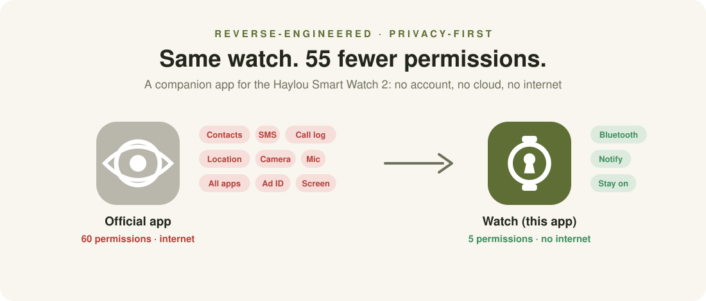
</p>

<h1 align="center">Watch: a privacy-first companion app for the Haylou Smart Watch 2</h1>

<p align="center">
  An Android app, written in Flutter, that talks to the <b>Haylou Smart Watch 2 (LS02)</b> over Bluetooth Low Energy.<br>
  It has no account, no cloud and no analytics, and it asks for <b>5 permissions instead of 60</b>.
</p>

---

## Why this exists

The official app (`com.yingsheng.hayloufun`, v4.0.8) asks for **60 permissions** to drive a watch that shows the time, counts steps and buzzes when a message arrives. They include contacts, SMS (read *and* send), call log, phone calls, camera, microphone, calendar, background location, `QUERY_ALL_PACKAGES`, the advertising ID and screen capture.

I didn't want to give all of that to a watch app. So I worked out how the watch talks to the phone and wrote my own app that does only what I need:

| | Official app | This app |
|---|---|---|
| Permissions | 60 | **5**: `BLUETOOTH_SCAN` (flagged `neverForLocation`), `BLUETOOTH_CONNECT`, `FOREGROUND_SERVICE`, `FOREGROUND_SERVICE_CONNECTED_DEVICE`, `POST_NOTIFICATIONS` |
| Internet | yes | **none** (the app has no `INTERNET` permission) |
| Notifications forwarded | everything it can read | **only the apps you tick**; all other notifications are dropped before their text is read |
| Account / cloud | required | none; health data stays on the phone for 30 days |
| Vendor SDK | bundled | **none**. Only the byte format of the Bluetooth messages was used as a reference |

Notification access is a separate system setting that you turn on yourself, so it isn't counted in the 5.

---

## The journey

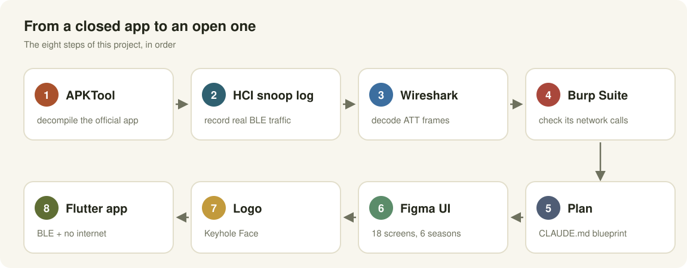

Each step below says what I did, which tool I used, and what I learned from it.

### 1. Decompile the official app (APKTool)

I pulled the APK off the phone and decoded it:

```bash
adb shell pm path com.yingsheng.hayloufun          # find the APK on the phone
adb pull <path>/base.apk hayloufun.apk
apktool d hayloufun.apk -o hayloufun               # smali + resources + manifest
```

What I learned:

- **`AndroidManifest.xml`** lists all 60 permissions, which is where the comparison table above comes from.
- **`smali_classes7/com/yingsheng/protocol/youcy/`** holds the watch protocol: `UteCmdTask`, `SendMsgTask`, `SetWeatherTask`, `AGpsTask`, plus `constants/YoucyWatchBleUUIDs` for the Bluetooth service IDs.
- An opcode table (`td/a`) and the command builders (`rd/*`) showed what each command byte means: units, profile, find watch, factory reset, steps, heart rate, sleep and notifications.

There was one catch. The decompiled `BleDeviceFactory` suggested the LS02 uses the "Apex `0x8800`" stack, and **that turned out to be wrong for my watch**. Code tells you what an app *can* do. It doesn't tell you which code path your device actually uses, so I needed a recording of real traffic.

### 2. Record real Bluetooth traffic (HCI snoop log)

Android can log every Bluetooth packet the phone sends and receives:

1. Turn on **Developer options → Enable Bluetooth HCI snoop log**, then toggle Bluetooth off and on.
2. Use the official app normally: connect, open battery, sync and so on.
3. Pull the log with a bug report. This phone is non-rooted, so the log can't be pulled directly:
   ```bash
   adb bugreport haylou_report.zip
   # the log is inside: FS/data/misc/bluetooth/logs/BT_HCI_<date>.cfa.curf
   ```

The file has an odd `.cfa.curf` extension, but it's a standard **btsnoop** file and Wireshark opens it directly.

### 3. Decode the frames (Wireshark)

I opened the capture in Wireshark, filtered on `btatt`, and lined up each packet with what I'd done in the app.

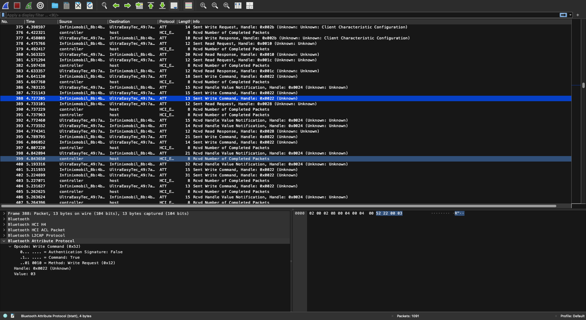

*Frame 388: the phone sends a **Write Command** (ATT `0x52`) to handle **`0x0022`** with the value **`03`**. That's the "get battery" request. A moment later the watch replies on handle `0x0024` with `03 1E`, and `0x1E` = 30, which matched the 30 % the official app showed.*

What the capture showed:

- **Channel:** service `0x60FF`. Commands go out on characteristic `0x6001` and replies come back as notifications on `0x6002`.
- **Format:** raw `[opcode][payload…]` with **no length field and no checksum**. The reply starts with the same opcode, so pairing replies to requests is easy.
- **No pairing or bonding.** There's no SMP and no encryption in the capture, just a plain GATT connection.
- **The whole connect sequence**, which my app now replays:

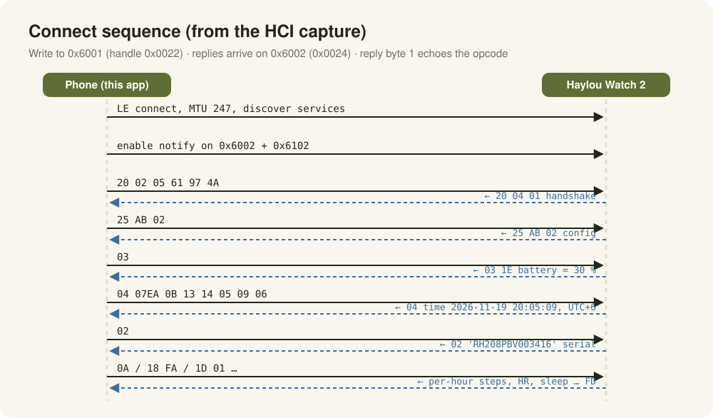

Then I tested each command on the real watch. For example, sending set-time and checking the watch face:

<p align="center">
  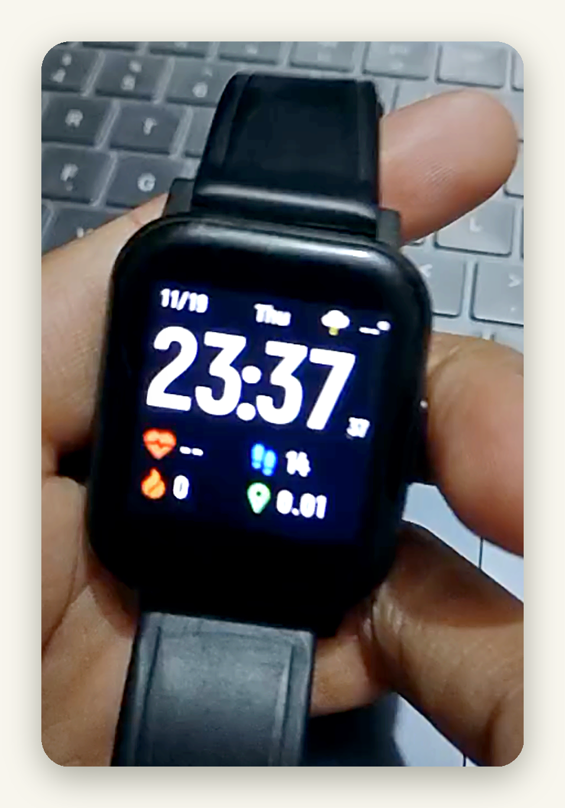
  &nbsp;&nbsp;
  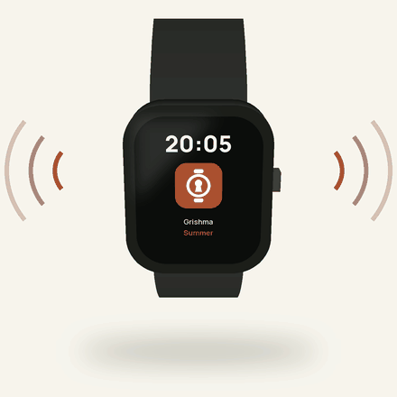
</p>
<p align="center"><i>Left: the real watch after this app set its time. Right: the companion app's logo in every season.</i></p>

To figure out a single setting, I did **one action at a time** in the official app, looked for the new bytes in the capture, guessed what they meant, and then changed the value from my own app to confirm. The full command map, with every opcode I confirmed, is in [lib/protocol/commands.dart](lib/protocol/commands.dart) and [.claude/CLAUDE.md](.claude/CLAUDE.md#2-target-device--protocol-reverse-engineered--ground-truth).

> ⚠️ Opcode `07` is **factory reset**. It's blocked in code and never sent.

### 4. Check the app's network traffic (Burp Suite)

The Bluetooth side was now clear. Next I wanted to see what the official app sends **over the internet**. I set up an emulator whose HTTPS traffic Burp Suite can read:


- A rooted Android emulator (`Pixel_Rootable`) started with a writable `/system`.
- Burp's CA certificate copied into the system trust store and bind-mounted over `/apex/com.android.conscrypt/cacerts`, which is the store Android 14+ apps actually read.
- The global proxy pointed at Burp (`10.0.2.2:8080`).

This led to the project's main rule: **the new app makes no network connections at all.** It has no `INTERNET` permission, never calls the vendor's servers and bundles no vendor SDK.

### 5. Plan

Before writing any code I wrote down the plan in [.claude/CLAUDE.md](.claude/CLAUDE.md), and I kept it up to date as I learned more:

- **Scope:** what to build (connect, battery, time, find watch, settings, health, notifications) and what never to build (firmware updates, which could brick the watch, cloud features and accounts).
- **Stack:** Flutter, `flutter_blue_plus`, Riverpod, `permission_handler` and `shared_preferences`. **There are no other Dart dependencies.** Charts are drawn by hand with `CustomPaint`.
- **Layers:** the protocol code is pure Dart (bytes in, data out), so it can be unit-tested with the captured bytes and no watch.
- **Phases:** scaffold, Bluetooth connection, protocol core, MVP screens, settings, health, notifications, then hardening. Each phase ended with a working build on a real phone (Infinix X6831, Android 13).
- **Permissions:** each one is justified, and nothing gets added quietly.

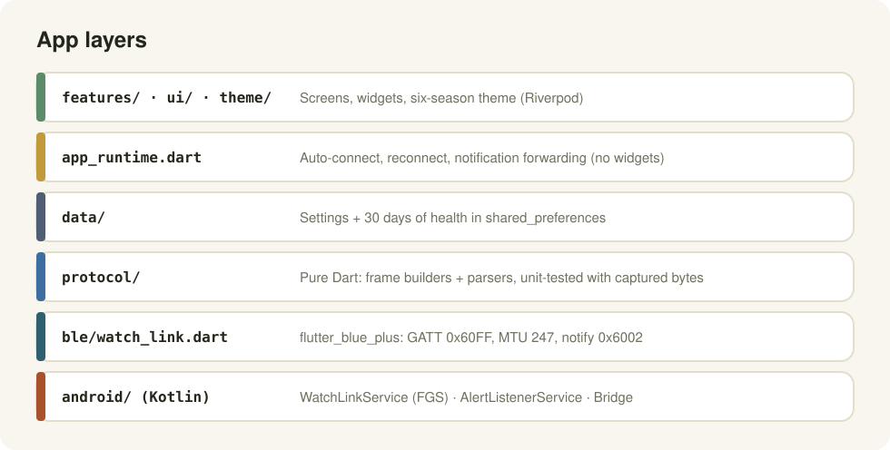

### 6. Design the UI (Figma)

I designed all **18 screens** in Figma before building them: onboarding, permissions, scan, home, health, settings, theme, the Alerts tab and app picker, and a debug console.

The colours are Figma variables in one **"Season" collection with 6 modes**, one per Bangladeshi season (ঋতু). The app follows the revised Bengali calendar: 1 Boishakh is 14 April, and a new season starts on 14 Apr, 15 Jun, 16 Aug, 17 Oct, 16 Dec and 14 Feb. Each mode maps to a `SeasonColors` theme extension in [lib/theme/palette.dart](lib/theme/palette.dart). The theme changes automatically, or you can pick a season yourself.

Fonts are **Manrope** for the UI and **Hind Siliguri** for Bengali. Both are bundled in the app, so it never downloads fonts.

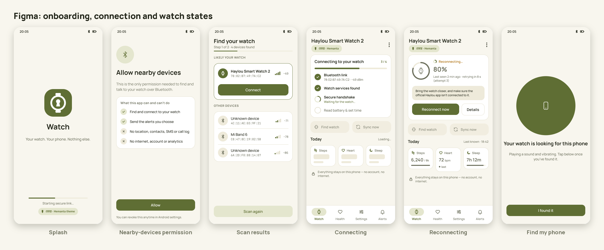

*Every connection state was designed before it was coded: first launch, the single permission screen ("What this app can and can't do"), scanning, the step-by-step connect card, reconnecting with a countdown, and the full-screen "find my phone" alert started from the watch.*

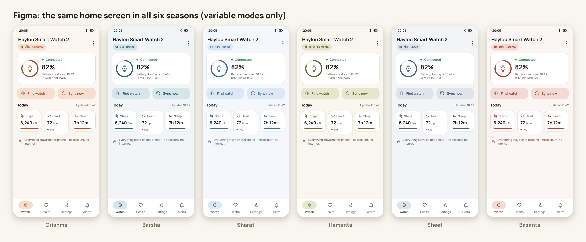

*One screen, six seasons. Only the variable mode changes, so there are no extra screens to maintain. The Flutter theme works the same way: one set of widgets, six palettes.*

### 7. Logo

I drew five icon ideas in Figma and checked each one as a launcher icon (squircle and circle), as an Android 13 themed icon, and at notification sizes (24, 48 and 96 px):

<p align="center">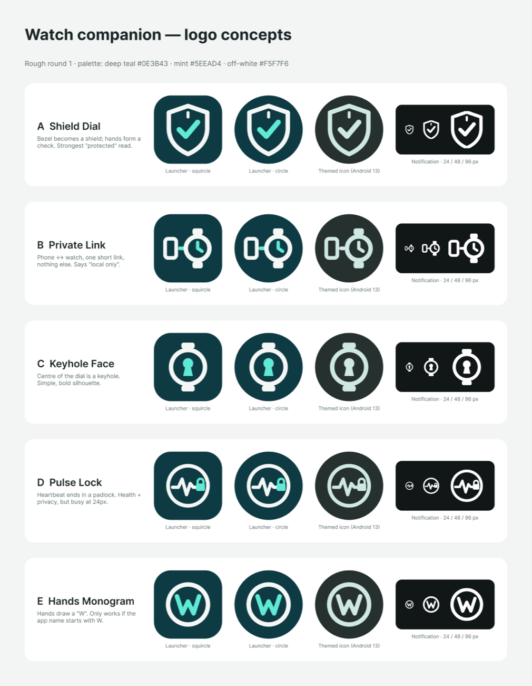</p>

- **A Shield Dial:** the bezel becomes a shield and the hands form a check mark. The strongest "protected" message.
- **B Private Link:** phone ↔ watch with one short link and nothing else. It says "local only".
- **C Keyhole Face:** the centre of the dial is a keyhole. A simple, bold silhouette.
- **D Pulse Lock:** health + privacy, but too busy at small sizes.
- **E Hands Monogram:** only works if the app's name starts with W.

I picked **C, "Keyhole Face"**: a watch with a keyhole in the middle, because the watch's data stays locked to your phone. Round 1 was a single teal palette. The final version takes its colour from the season:

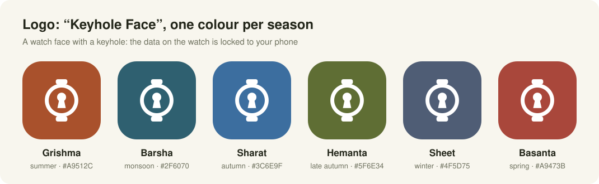

The same shape is used in three places:

- [lib/ui/logo.dart](lib/ui/logo.dart): drawn in code, coloured for the current season
- `res/drawable/ic_launcher_foreground.xml` and `ic_launcher_monochrome.xml`: the adaptive launcher icon
- `res/drawable/ic_stat_watch.xml`: the status-bar icon

The **launcher icon changes colour with the season.** There are six `activity-alias` entries and the app switches between them. The switch waits until the app is in the background, because switching a visible activity closes it.

### 8. Build the app (Flutter)

<p align="center">
  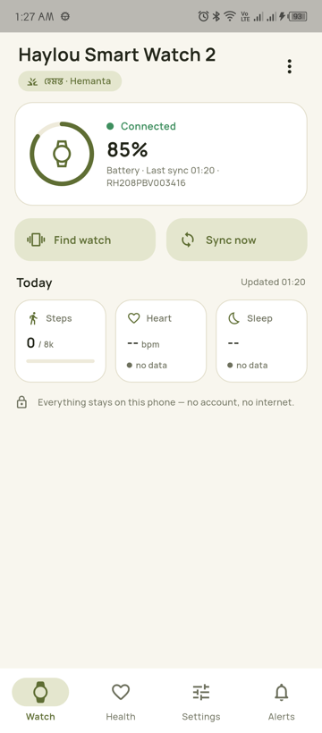
  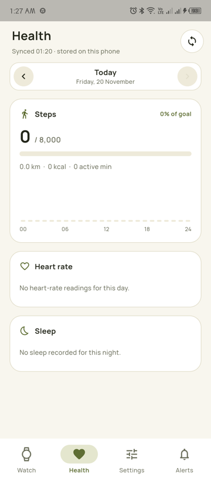
  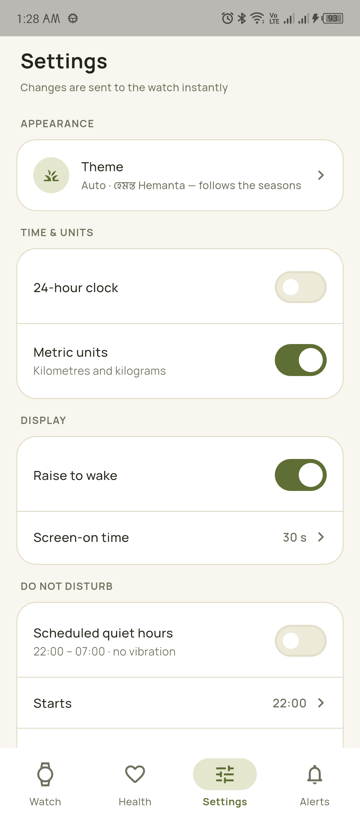
  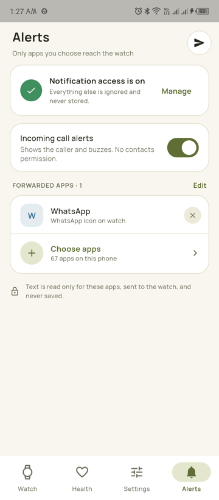
</p>
<p align="center"><i>Watch · Health · Settings · Alerts, in the Hemanta (late autumn) theme</i></p>

**Features**

- **Watch:** scan and connect, battery level, serial number, find watch (buzz), sync now. It reconnects on its own with a countdown, waiting 2 s, then longer up to 30 s.
- **Health:** steps per hour (with distance, calories and active minutes), heart rate every 10 minutes, sleep stages (deep, light, awake, REM), and live heart rate. Data is kept on the phone for 30 days.
- **Settings:** 24-hour clock, metric or imperial units, raise to wake, screen-on time, Do Not Disturb hours, sedentary reminder, profile (height, weight, age, step goal) and theme.
- **Alerts:** forwards notifications only from the apps you pick. Incoming calls show the caller's name and buzz the watch, using the dialer's own notification, so the app needs **no contacts or phone-state permission**.
- **Background:** a foreground service keeps the connection alive with a single "Connected" notification.
- **Theme:** six colour palettes, one for each season of Bangladesh. The theme follows the Bengali calendar on its own, or you can pick one yourself (see [below](#the-six-season-theme)).
- **Debug console:** shows the raw Bluetooth traffic in hex. Debug builds also print it to logcat as `[ble] …`.

**Main code**

| Path | What it does |
|---|---|
| [lib/ble/watch_link.dart](lib/ble/watch_link.dart) | Bluetooth connection: GATT, MTU 247, notifications, writes |
| [lib/protocol/commands.dart](lib/protocol/commands.dart) | Builds and parses frames (pure Dart) |
| [lib/protocol/history.dart](lib/protocol/history.dart) | Decodes step, heart-rate and sleep history |
| [lib/protocol/watch_session.dart](lib/protocol/watch_session.dart) | Handshake and request/response matching |
| [lib/features/device/watch_controller.dart](lib/features/device/watch_controller.dart) | Connection state (Riverpod). A lock keeps multi-frame transfers from mixing |
| [lib/app_runtime.dart](lib/app_runtime.dart) | Logic that runs with the UI closed: auto-connect, reconnect, forwarding |
| [android/…/WatchLinkService.kt](android/app/src/main/kotlin/com/haylou/watch/WatchLinkService.kt) | Foreground service that keeps the app alive in the background |
| [android/…/AlertListenerService.kt](android/app/src/main/kotlin/com/haylou/watch/AlertListenerService.kt) | Notification listener that drops apps not on your list before reading anything |

---

## The six-season theme

Bangladesh has six seasons (ষড়ঋতু), each two Bengali months long. The app has one palette for each season and **changes its look automatically when the season changes**, using the revised Bengali calendar (বঙ্গাব্দ) that Bangladesh uses. Nothing is downloaded: the date math runs on the phone.

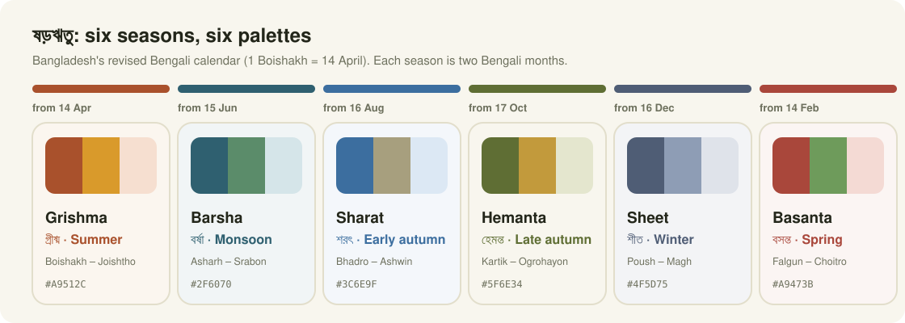

<table>
<tr>
<td width="300">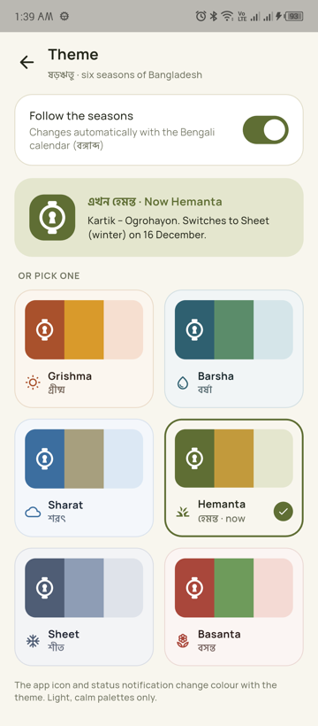</td>
<td>

**Settings → Theme**

- **Follow the seasons** (on by default): the app works out today's Bengali date and picks the season, for example *এখন হেমন্ত · Now Hemanta*. It also tells you when the next season starts: *"Switches to Sheet (winter) on 16 December."*
- **Or pick one:** tap any of the six cards to keep that season's palette all year.
- **The whole app changes, not just the screens:** the logo, the **launcher icon** (one of six colour versions) and the colour of the "Connected" status notification all follow the season.
- The theme updates at midnight and whenever the app comes back to the screen, so it's never a day behind.
- Palettes are light and calm on purpose. The Bengali text uses the bundled Hind Siliguri font.

</td>
</tr>
</table>

**How it works**

| Piece | File |
|---|---|
| Seasons + Bengali calendar (1 Boishakh = 14 Apr; Boishakh–Ashwin have 31 days, Falgun 29 or 30 in a leap year, the rest 30) | [lib/theme/season.dart](lib/theme/season.dart) |
| Colours for each season (the same values as the Figma variables) | [lib/theme/palette.dart](lib/theme/palette.dart) |
| Material theme built from a palette | [lib/theme/app_theme.dart](lib/theme/app_theme.dart) |
| Auto/manual choice, "today" that ticks at midnight, the active season | [lib/theme/theme_controller.dart](lib/theme/theme_controller.dart) |
| Theme screen | [lib/features/settings/theme_screen.dart](lib/features/settings/theme_screen.dart) |
| Launcher icon switch: six `activity-alias` entries, swapped once the app is in the background | [AndroidManifest.xml](android/app/src/main/AndroidManifest.xml), [Bridge.kt](android/app/src/main/kotlin/com/haylou/watch/Bridge.kt) |
| Calendar tests (season boundaries, month starts, the year wrapping around) | [test/theme/season_test.dart](test/theme/season_test.dart) |

---

## Build and run

Requirements: Flutter 3.47+ (Dart 3.13), an Android phone running **Android 12 or later** (minSdk 31), and a Haylou Smart Watch 2.

```bash
flutter pub get
flutter test                 # 34 protocol + calendar tests, no watch needed
flutter devices
flutter run -d <device_id>
```

Before you start:

- **Close the official app.** The watch only accepts one phone connection at a time.
- **Turn on Location while scanning.** The app has no location permission, but Android 13 still blocks Bluetooth scans when the system Location switch is off. Once the watch is saved, the app reconnects by its address and Location can stay off.
- To forward notifications, open **Alerts → Manage** and allow **Notification access**.

---

## What's not here (on purpose)

- **Firmware updates.** One bad update could brick the watch.
- **Custom watch faces**, weather, alarms, SpO₂ and stress.
- **iOS.** iOS doesn't let apps read other apps' notifications, and it restricts background Bluetooth.

---

## Disclaimer

This is a personal project for interoperability with a device I own. No code from the official app or the vendor's SDK is included. Only the Bluetooth byte format, seen in my own traffic captures, was used as a reference. "Haylou" is a trademark of its owner, and this project isn't affiliated with or endorsed by Haylou.
